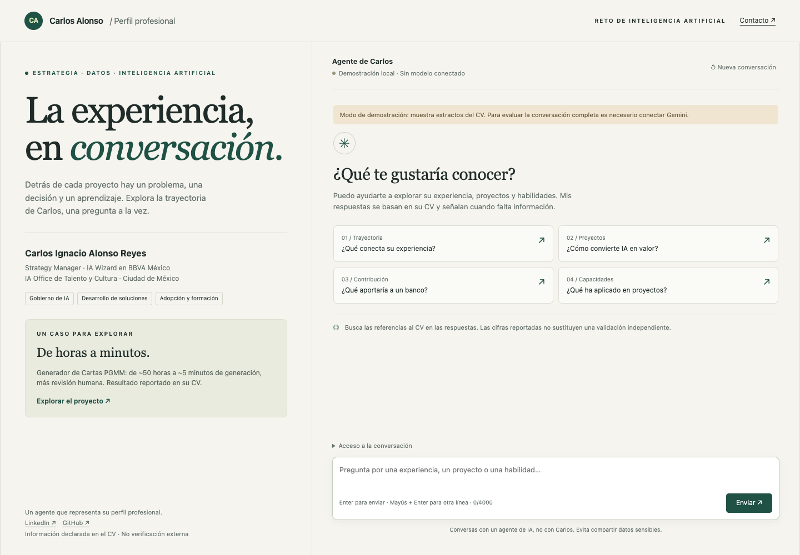
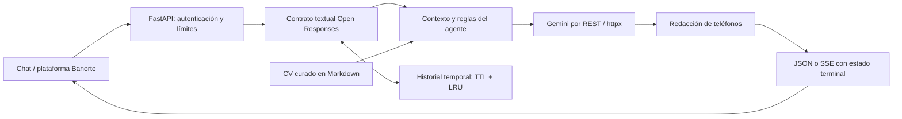

# Carlos Alonso · Experiencia en conversación

Agente de CV para el **Reto IA Banorte — Especialista Sr. de Inteligencia Artificial e Innovación**. Permite explorar la experiencia, proyectos y habilidades de Carlos Ignacio Alonso Reyes mediante respuestas basadas en su CV, con referencias a secciones y reconocimiento de información ausente.

**Propuesta de valor:** reducir la fricción entre leer un perfil y encontrar evidencia útil para una conversación profesional. La posible evolución a descubrimiento de capacidades internas se plantea como un piloto por validar, no como una solución ya implantada.



## Estado de la entrega

| Componente | Estado |
|---|---|
| Código, chat y endpoint textual | Implementados y comprobados localmente |
| Base de conocimiento | Seis documentos cotejados con el CV aportado; no verificación externa de logros |
| Pruebas de servidor y proveedor | Sin red, con respuestas controladas; ver [VALIDACION.md](docs/VALIDACION.md) |
| Modelo | Gemini configurable; predeterminado `gemini-3.5-flash-lite` |
| Calidad con Gemini real | 34 casos completados; 33 aprobados automáticamente y hallazgos de revisión documentados en [resultados](docs/RESULTADOS_GEMINI.md) |
| Código público | [Aloner23/cv-agent-banorte](https://github.com/Aloner23/cv-agent-banorte) |
| HTTPS y registro en Banorte | Pendientes de despliegue e integración |

## Lectura para el evaluador

- [Propuesta de negocio](docs/PROPUESTA_DE_VALOR.md): problema, usuarios, piloto de cuatro semanas, indicadores y caso económico ilustrativo.
- [Decisiones técnicas](docs/DECISIONES_TECNICAS.md): alternativas, razones, costos y límites del diseño.
- [Guion de demostración](docs/DEMO.md): conversación de seis minutos y respuestas a preguntas técnicas.
- [Fuentes y límites](docs/FUENTES_Y_LIMITES.md): cotejo documental, trazabilidad y significado de las cifras.
- [Validación](docs/VALIDACION.md): evidencia de lo probado y límites de esa evidencia.
- [Operación y entrega](docs/OPERACION.md): conexión de Gemini, publicación, registro y recuperación ante fallos.

## Arquitectura



| Decisión | Razón | Límite asumido |
|---|---|---|
| Contexto completo por defecto | El corpus es pequeño y las preguntas de síntesis necesitan varias secciones | Consume tokens en cada solicitud; no garantiza fidelidad |
| BM25 opcional | Permite comparar recuperación léxica sin un servicio adicional | Puede perder sinónimos o contexto; no se afirma que mejore calidad sin medir |
| Gemini y adaptadores separados | Conserva el avance y desacopla el cliente del proveedor | Cambiar de modelo exige reevaluar; no hay respaldo automático |
| FastAPI + REST directo | Flujo asíncrono compacto y fácil de inspeccionar | El proyecto mantiene el contrato y el parseo SSE |
| Evidencia y abstención | Evita presentar una estimación como beneficio comprobado | Las citas son solicitadas al modelo, no verificadas semánticamente por código |
| Memoria temporal de una instancia | Suficiente para el reto, con capacidad y caducidad explícitas | Se pierde al reiniciar; no hay aislamiento por visitante ni escalado horizontal |

El modelo predeterminado se actualizó porque Google limita el acceso a Gemini 2.5 a usuarios anteriores y recomienda modelos recientes para proyectos nuevos. `gemini-3.5-flash-lite` aparece como estable; la disponibilidad para una cuenta concreta se debe comprobar con una llamada real. No se afirma que sea el mejor modelo sin evaluación. [Catálogo oficial](https://ai.google.dev/gemini-api/docs/models), [ficha del modelo](https://ai.google.dev/gemini-api/docs/models/gemini-3.5-flash-lite).

## Iniciar la demostración local

Requiere Python **3.12**. Desde la raíz del repositorio:

```bash
python3.12 -m venv .venv
source .venv/bin/activate
pip install -r requirements-dev.txt -c constraints.txt
LLM_PROVIDER=mock uvicorn app.main:app --host 127.0.0.1 --port 8000
```

Abrir `http://127.0.0.1:8000`. El modo `mock` devuelve extractos de la fuente y se identifica en pantalla: permite probar el servicio sin clave, pero no demuestra razonamiento ni calidad del modelo.

## Conectar Gemini

Copiar `.env.example` a `.env` y editar ese archivo localmente:

- `GEMINI_API_KEY`: credencial de Google AI Studio; sólo la utiliza el servidor.
- `AGENT_API_KEY`: secreto distinto para dar acceso al endpoint y a la plataforma del reto.
- `LLM_PROVIDER=gemini` y `LLM_MODEL=gemini-3.5-flash-lite`.

No publicar `.env` ni introducir la clave de Gemini en el chat web. El archivo está excluido de Git. Obtener la credencial en [Google AI Studio](https://aistudio.google.com/apikey).

```bash
uvicorn app.main:app --env-file .env --host 127.0.0.1 --port 8000
```

`--env-file` carga configuración sin ejecutar el contenido como código de shell. `/health` muestra el proveedor y la revisión del corpus. `/ready` valida sólo configuración local: aunque devuelva 200, todavía hay que probar conectividad, cuota y respuesta real.

## Contrato de integración

`POST /v1/responses`, autenticación `Authorization: Bearer <AGENT_API_KEY>` si está configurada.

```json
{
  "model": "carlos-cv-agent",
  "input": "¿Qué proyectos ha desarrollado Carlos? Distingue resultados de estimaciones.",
  "stream": true
}
```

El identificador público es el del agente, no el nombre del modelo Gemini. Para un turno posterior, enviar el nuevo `input` y `previous_response_id` de una respuesta almacenada. Con `store=false` no se puede recuperar ni continuar esa respuesta por id; el cliente puede reenviar su historial textual.

**Admitido:** entrada string o mensajes con contenido textual; instrucciones del cliente como preferencias subordinadas; `stream`, `store`, `previous_response_id`, `metadata`, `max_output_tokens`, `temperature` entre 0 y 1. La salida es texto, con `tools=[]`, `truncation=disabled`, `background=false`; no hay compactación automática.

**Fuera de alcance:** herramientas, imágenes, audio, JSON estructurado, ejecución en segundo plano y WebSockets. Las capacidades no implementadas devuelven 400 en lugar de simularse. La especificación completa evoluciona: esto es una implementación de su superficie textual, no una certificación de conformidad. [Open Responses](https://www.openresponses.org/specification).

Streaming: eventos de creación, mensaje, parte, deltas y cierre, con secuencia creciente. El estado final distingue `response.completed`, `response.incomplete` por límite de salida y `response.failed`. Un fallo transmite un evento `error`; el stream termina con `[DONE]`.

Rutas adicionales: `/` (chat), `/health` (proceso/configuración), `/ready` (200 o 503), `/v1/models`, `/v1/responses/{id}` y `/docs`.

## Pruebas y evaluaciones

```bash
LLM_PROVIDER=mock python -m pytest -q
python -m evals.run_evals --url http://127.0.0.1:8000 --mode mock-smoke
```

La primera orden valida servidor, memoria, privacidad numérica y proveedor simulado. La segunda hace una prueba HTTP de tres casos en modo `mock`; su reporte dice explícitamente que no evalúa calidad.

Para el servicio con Gemini, cargar las variables sin imprimir secretos y ejecutar:

```bash
python -m dotenv -f .env run -- python -m evals.run_evals --url https://TU-SERVICIO.onrender.com
python -m dotenv -f .env run -- python -m evals.run_evals --url https://TU-SERVICIO.onrender.com --judge
```

Hay 34 casos: hechos, síntesis, varios turnos, información ausente, privacidad, inyección, idioma, alcance y matices de impacto. El modo de calidad rechaza endpoints `mock`. Los reportes registran proveedor, modelo, huella del corpus, fecha, respuestas, fallos y latencias. El juez es una señal auxiliar con umbrales; puede compartir errores con el modelo y no reemplaza la revisión humana.

## Límites operativos

- Entrada: 4,000 caracteres por mensaje de usuario; cuerpo HTTP: 64 KiB.
- Conversación: hasta 12 intercambios previos y 16,000 caracteres totales, sin eliminar silenciosamente contexto.
- Salida: hasta 900 tokens, incluso si el cliente pide más. Tiempo total: hasta 90 segundos.
- Memoria: hasta 200 respuestas; caducidad de una hora desde su almacenamiento.
- Solicitudes: 30/minuto por IP observada. Detrás de un proxy se debe configurar su confianza explícitamente; sin ella, varios clientes pueden compartir límite.
- CORS cerrado por defecto; el chat utiliza el mismo origen. Autorizar sólo orígenes necesarios mediante `CORS_ORIGINS`.
- La clave de acceso y el historial del chat no se guardan en almacenamiento persistente del navegador. El servidor conserva temporalmente las conversaciones si `store=true`.
- No se promete protección contra toda inyección, identificación de todo dato personal, cifrado en memoria, aislamiento multiusuario ni aptitud para producción bancaria.

## Publicar

[render.yaml](render.yaml) define una instancia de demostración con Gemini explícito y una clave de acceso autogenerada. `constraints.txt` fija las versiones verificadas de dependencias. El repositorio público está creado; el despliegue permanece pendiente de configurar y comprobar el alojamiento. Los pasos y la comprobación de aceptación están en [OPERACION.md](docs/OPERACION.md).
