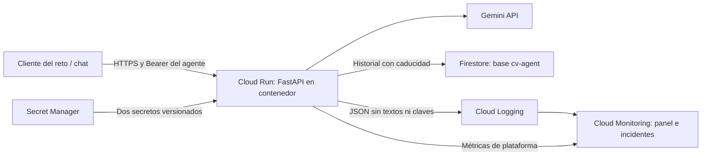

# Cloud Run: contenedor, estado compartido y observabilidad

## Estado

Configuración preparada y pruebas locales documentadas. El endpoint actualmente verificado sigue en Render; no se afirma despliegue efectivo en Cloud Run hasta completar la aceptación de abajo.

## Arquitectura



El contenedor corre con usuario sin privilegios y dependencias fijadas. Cloud Build construye la imagen y Artifact Registry la conserva. `.gcloudignore` limita la carga a archivos de ejecución; `.dockerignore` limita el contexto de imagen. No se envían `.env`, documentos de entrevista, PDF, historial Git ni reportes locales.

La cuenta `cv-agent-runtime` sólo recibe lectura de los dos secretos y `roles/datastore.user` condicionado a la base `cv-agent`. La cuenta de construcción es distinta; sus permisos se revisan al desplegar. No se presupone que las cuentas predeterminadas tengan el rol Editor.

## Continuidad y retención

`RESPONSE_STORE_BACKEND=firestore` permite recuperar `previous_response_id` desde otra instancia o revisión. Las consultas usan IDs aleatorios y autenticación del agente; no existe aislamiento entre identidades individuales porque el demostrador comparte una clave. No usar datos privados ni múltiples usuarios empresariales sin ese aislamiento.

Las conversaciones expiran lógicamente al cabo de una hora: el servidor rechaza lecturas vencidas aunque Firestore todavía conserve el documento. El borrado físico por TTL es asíncrono y normalmente tarda hasta 24 horas adicionales, sin garantía de inmediatez. `store=false` evita escritura; el cliente también puede reenviar la transcripción. Las operaciones de base tienen timeout y no reintentan indefinidamente. Un fallo al persistir produce 503 o `response.failed` en SSE, nunca un éxito con continuidad inexistente.

El límite de 200 registros sólo aplica al backend local en memoria, no a Firestore. El volumen compartido depende de tráfico y retención. La tasa por IP también es local a cada instancia, no una cuota global.

## Despliegue

Requiere proyecto explícito con facturación habilitada y autorización para costos, secretos y permisos. Desde un checkout limpio:

```bash
PROJECT_ID=tu-proyecto ./deploy/cloudrun.sh
```

El script no cambia el proyecto global de gcloud. Solicita las claves sólo si los secretos no existen y fija sus versiones numéricas. Mantener Render mientras se valida la nueva URL. La API de Gemini sigue siendo la configurada; esto no migra el modelo a Vertex AI.

La configuración usa 0–2 instancias, 1 CPU, 512 MiB, concurrencia 20 y timeout 120 s. Son valores iniciales para medir, no límites financieros ni resultados de carga. Escalar a cero puede generar arranque en frío; no se promete una latencia fija. Cloud Build, Artifact Registry, Firestore, Secret Manager, logs y Gemini pueden generar costos aun con poco tráfico. Configurar presupuesto y alertas de facturación; un presupuesto alerta, no detiene por sí solo el consumo.

## Observabilidad reproducible

```bash
# Sólo genera JSON revisable, no crea recursos:
python deploy/observability.py --project tu-proyecto
# Instala métricas, panel y política:
python deploy/observability.py --project tu-proyecto --apply
# Para notificar, proporcionar un canal existente autorizado:
python deploy/observability.py --project tu-proyecto --channel projects/tu-proyecto/notificationChannels/ID --apply
```

Panel: solicitudes, instancias, latencia p95, primer texto p95, tokens de entrada/salida p95 por respuesta y fallos terminales. Los percentiles de tokens no equivalen a gasto total; conciliar facturación del proveedor y sumar registros de uso para medir costo. Las métricas por logs se agregan entre instancias y sólo incluyen eventos posteriores a su creación; pueden tardar en aparecer.

La política abre un incidente con tres fallos terminales en cinco minutos; sin canal los incidentes sólo se consultan en la consola. Incluye fallos de SSE aunque el HTTP inicial sea 200. El log `response_failed` y `error_code` permiten distinguir cuota, timeout y almacenamiento. `/metrics` permanece como diagnóstico local por instancia.

Filtro de diagnóstico:

```text
resource.type="cloud_run_revision"
resource.labels.service_name="carlos-cv-agent"
jsonPayload.message="response_failed"
```

Se correlacionan logs por `request_id` y el identificador de trace entrante. Esto no implica instrumentación completa de spans distribuidos. No registrar preguntas, respuestas, tokens de acceso ni claves en logs.

## Aceptación antes de cambiar el endpoint del reto

- Comprobar `/health`: versión, commit, prompt, corpus y backend `firestore`.
- Probar JSON, SSE y rechazo 401 sin clave.
- Crear una respuesta, desplegar otra revisión y continuar mediante su ID: demuestra continuidad entre procesos.
- Probar `store=false` y caducidad; revisar la política TTL habilitada.
- Generar una solicitud válida, localizar su `X-Request-ID` en logs y verificar métricas del panel.
- Ejecutar fallos controlados de proveedor en pruebas locales; cualquier ejercicio real se hace en un servicio de ensayo, sin romper el agente del reto.
- Identificar revisión anterior y ensayar recuperación antes de retirar Render.

Rollback de tráfico (sustituir los valores):

```bash
gcloud run services update-traffic carlos-cv-agent --project tu-proyecto --region us-central1 --to-revisions REVISION_ANTERIOR=100
```

## Referencias

- [Logs de Cloud Run](https://docs.cloud.google.com/run/docs/logging)
- [Métricas integradas](https://docs.cloud.google.com/run/docs/monitoring)
- [Afinidad no garantizada entre instancias](https://docs.cloud.google.com/run/docs/configuring/session-affinity)
- [TTL de Firestore](https://firebase.google.com/docs/firestore/ttl)
- [Control de acceso por base](https://firebase.google.com/docs/firestore/manage-databases)
