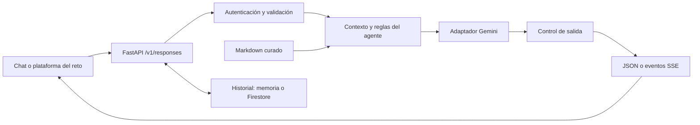

# Decisiones técnicas y sus límites

Este documento explica la lógica del diseño del agente de CV. Distingue lo implementado, lo que debe verificarse en el despliegue y la evolución que tendría sentido si cambia el problema. La existencia de código o de pruebas no acredita por sí sola un despliegue exitoso ni la calidad de un modelo real.

## 1. Un flujo acotado para un problema acotado

El servicio recibe una pregunta, selecciona el contexto profesional, consulta un modelo y entrega una respuesta. No necesita actuar en sistemas externos para explicar un CV. Por eso se evita un ciclo abierto de herramientas y se mantiene visible dónde entran los datos, dónde se aplican límites y dónde puede fallar el proveedor.

La propuesta comercial derivada se desarrolla en [PROPUESTA_DE_VALOR.md](PROPUESTA_DE_VALOR.md). El demostrador no incorpora aún la arquitectura de identidad y autorización necesaria para consultar perfiles de varios empleados.

## 2. Gemini configurable: continuidad y posibilidad de comparación

**Decisión.** Conservar Gemini, elegido por Carlos y ya integrado en el avance. Separar el nombre público del agente del proveedor y modelo reales mediante configuración. El adaptador está en [providers.py](../app/providers.py).

**Por qué.** Mejorar y verificar un flujo existente tiene más valor inmediato que migrarlo sin una hipótesis de calidad, costo o latencia. La interfaz común permite comparar proveedores con las mismas preguntas y cambiar la implementación sin modificar el cliente del reto.

**Costo y límite.** Esta elección no demuestra que Gemini sea el mejor o más barato. Cada proveedor difiere en roles, uso de tokens, errores, límites y finalización. Un cambio por configuración debe acompañarse de pruebas y una nueva evaluación; no equivale a un reemplazo semánticamente idéntico. Los adaptadores alternativos no constituyen un respaldo automático en caso de caída.

El modelo inicial de esta revisión es `gemini-3.5-flash-lite`. Se actualizó desde 2.5 Flash porque el catálogo de Google restringe la familia 2.5 a usuarios anteriores y recomienda modelos recientes para nuevos proyectos. La ficha consultada el 30 de octubre de 2026 lo identifica como estable; debe validarse acceso y calidad en la cuenta del titular. [Catálogo oficial](https://ai.google.dev/gemini-api/docs/models), [ficha de 3.5 Flash-Lite](https://ai.google.dev/gemini-api/docs/models/gemini-3.5-flash-lite).

**Cuándo reconsiderarla.** Si el modelo incumple la calidad acordada, cambia su disponibilidad o no satisface los requisitos del entorno objetivo. Comparar calidad, latencia, costo medido y tratamiento de datos con contenido autorizado. No migrar por popularidad.

## 3. Contexto completo para seis documentos

**Decisión.** Usar `KNOWLEDGE_MODE=full` para cargar el corpus pequeño del CV. La implementación está en [knowledge.py](../app/knowledge.py).

**Por qué.** Preguntas como «Resume la trayectoria» cruzan experiencia, proyectos y formación. Enviar todas las secciones evita que una recuperación defectuosa excluya un dato necesario. También simplifica depuración: es posible reconstruir qué información estaba disponible para la respuesta.

**Costo y límite.** El contexto se envía con cada solicitud y consume tokens; un contexto completo no obliga al modelo a usarlo correctamente. La presencia de una fuente tampoco valida su veracidad. Medir el tamaño con el modelo elegido y considerar instrucciones, historial y salida; no defender la decisión con una estimación fija de tokens sin medición.

El prefijo estable puede beneficiarse de caché del proveedor. Los ahorros dependen de un acierto real y de las condiciones del modelo; no se presuponen al calcular costos. [Documentación de caché de Gemini](https://ai.google.dev/gemini-api/docs/caching).

**Cuándo reconsiderarla.** Si crece el corpus, se degrada la calidad, el costo/latencia incumple objetivos o se necesitan permisos distintos por documento. En un servicio con varios usuarios, filtrar por autorización ocurre antes de construir el contexto.

## 4. BM25 opcional como alternativa medible

**Decisión.** Mantener recuperación léxica con BM25 como modo `retrieval`, sin base vectorial ni servicio de embeddings.

**Por qué.** El CV tiene términos concretos —empresas, herramientas y proyectos— para los que una búsqueda léxica es una base simple y explicable. Permite explorar el costo de reducir contexto y comparar respuestas con la misma evaluación.

**Costo y límite.** Una coincidencia léxica puede perder sinónimos, referencias de varios turnos y preguntas de síntesis; devolver los primeros resultados no garantiza que contengan la respuesta. No se presenta BM25 como «RAG empresarial» ni se afirma que supere a embeddings sin un experimento.

**Evolución.** Construir preguntas con pasajes esperados y medir recuperación, además de calidad final. `Recall@k = pasajes relevantes recuperados / pasajes relevantes esperados`. Probar búsqueda híbrida y reranking sólo si resuelven fallos observados; decidir por resultado y costo, no por un umbral arbitrario de tamaño.

## 5. Markdown curado y evidencia con alcance explícito

**Decisión.** El modelo consulta [knowledge/](../knowledge/), organizado por perfil, experiencia, proyectos, formación y liderazgo. El cotejo con el CV de origen se registra en [FUENTES_Y_LIMITES.md](FUENTES_Y_LIMITES.md).

**Por qué.** Facilita corregir fechas, atribuciones y estados; revisar cambios en Git; y separar contenido publicable de material interno. La maquetación del PDF no pasa directamente al contexto.

**Costo y límite.** Curar es una actividad editorial. Puede introducir omisiones o errores. «Fuente del agente» significa contenido disponible para responder, no una verificación independiente de la experiencia. Las cifras deben conservar los calificadores «reportado», «estimado» o «en desarrollo» que correspondan. La ausencia de un dato no demuestra que el hecho sea falso; sólo impide afirmarlo con estas fuentes.

El servidor normaliza referencias agrupadas y elimina ids que no están en el contexto, incluso en streaming. Preserva enlaces Markdown. Este control no comprueba que la afirmación esté sustentada. Las referencias a secciones permiten localizar el respaldo. Una referencia debe llevar a contenido que sustente la afirmación; mencionar un identificador válido no basta. Revisión humana y preguntas adversarias son necesarias para comprobar esa correspondencia.

**Evolución.** Registrar dueño, fecha de revisión, estado y evidencia por afirmación. Antes de ampliar el corpus, definir quién puede autorizar su publicación, corregirlo y retirarlo.

## 6. REST con httpx, con responsabilidad explícita sobre el protocolo

**Decisión.** Usar adaptadores REST pequeños con `httpx`, en lugar de sumar varios SDKs o un framework de orquestación.

**Por qué.** Un flujo de consulta y respuesta requiere pocas operaciones. Un contrato interno común hace visibles el payload, el streaming, los tokens y los errores de cada proveedor. Se reduce el número de abstracciones que el evaluador necesita recorrer.

**Costo y límite.** Menos dependencias no significa menos responsabilidad: el proyecto mantiene el parseo de eventos, timeouts, errores y cambios del proveedor. Los reintentos deben limitarse a fallos transitorios antes de emitir contenido; reiniciar una generación a mitad de stream puede duplicar texto y costo. Un reintento tampoco garantiza que el proveedor no haya facturado un intento previo.

**Cuándo reconsiderarla.** Si las funciones necesarias crecen o un SDK oficial reduce mantenimiento y errores, adoptarlo detrás del mismo contrato. Un framework sólo se justifica cuando sus capacidades resuelven complejidad real.

## 7. FastAPI y una superficie textual de Open Responses

**Decisión.** Servir una API HTTP asíncrona con respuestas JSON y SSE; traducir la conversación y eventos a una superficie de Open Responses mediante [openresponses.py](../app/openresponses.py) y [main.py](../app/main.py).

**Por qué.** El reto exige ese contrato de integración. La separación permite que la plataforma use el mismo agente independientemente de Gemini. FastAPI permite mantener la validación, las rutas, la autenticación y la transmisión de eventos en un servicio compacto.

**Alcance.** El servicio se concentra en mensajes de texto y continuidad de conversación. No implementar imágenes, herramientas o modalidades adicionales evita prometer funciones ajenas al CV. Los campos no soportados deben rechazarse explícitamente, no aceptarse simulando su ejecución.

**Verificación necesaria.** Comprobar esquema, orden de eventos, números de secuencia, respuesta terminal, errores y continuidad; después probar el cliente real del reto. La especificación exige que el tipo del evento coincida con su campo `event` y que el stream termine con un evento terminal; `[DONE]` puede seguirlo. Implementar parte de la especificación no equivale a certificar conformidad completa. [Especificación oficial de Open Responses](https://www.openresponses.org/specification).

## 8. Límites y controles en capas

**Decisión.** Combinar reglas del agente, validación, historial acotado, límites de salida, autenticación configurada y controles de exposición de datos.

**Por qué.** El prompt orienta al modelo; el servidor debe imponer lo que puede verificar de forma determinista. Un usuario no puede obtener más presupuesto o autoridad por solicitarlo en el chat. El agente habla de Carlos en tercera persona para identificar claramente que lo representa y no puede asumir compromisos en su nombre.

**Hallazgo real.** El juez aprobó respuestas que imitaban un personaje mientras lo negaban. Un recordatorio adicional tampoco lo resolvió. Por ello, las órdenes directas de cambiar identidad al principio del mensaje reciben una respuesta de alcance sin invocar al modelo; el resto conserva el flujo conversacional. Esta regla puede rechazar una reformulación legítima que comience igual y no cubre variantes no detectadas.

**Límites de la defensa.** Detectar palabras de inyección aporta una señal, no una garantía. Una expresión regular de teléfono no es un sistema general de prevención de fugas. Una API key compartida tampoco ofrece aislamiento por usuario. El historial aportado por el cliente puede contener afirmaciones inventadas: no debe convertirse en fuente de hechos.

**Controles para un piloto interno.** Identidad corporativa, permisos por documento, cuotas por usuario, rotación de secretos, reglas de retención, revisión del tratamiento de datos y pruebas de fuga entre usuarios. No se declara cumplimiento bancario por usar un proveedor conocido o por añadir un prompt de seguridad.

## 9. Estado compartido y ejecución serverless

**Decisión.** Cloud Run ejecuta el contenedor y Firestore conserva temporalmente las conversaciones consultadas mediante `previous_response_id`. La identidad del servicio accede sólo a la base `cv-agent` y a sus dos secretos. Render y el backend en memoria quedan como alternativa de desarrollo y respaldo.

**Por qué.** Una instancia serverless puede desaparecer o ser reemplazada al publicar otra revisión. Separar el estado permite continuar la conversación sin depender de un proceso específico. Se comprobó con una respuesta creada en la revisión `00002-v8x` y recuperada mediante SSE en `00003-jqd`.

**Costo y límite.** Firestore agrega lecturas, escrituras y retención, pero evita mantener una instancia Redis siempre encendida para este volumen. El historial caduca lógicamente al cabo de una hora y la política TTL activa solicita su limpieza física asíncrona. `store=false` evita almacenarlo. Un fallo de persistencia se comunica como error, no como éxito con continuidad inexistente.

El secreto compartido autentica la integración, no a cada visitante. Antes de incorporar datos internos o múltiples perfiles se requieren identidad individual, aislamiento y permisos. El backend en memoria de Render pierde historial al reiniciar y no comparte estado entre procesos. Ver [Cloud Run](CLOUD_RUN.md).

## 10. Evaluar contrato, contenido y utilidad por separado

| Capa | Qué demuestra | Qué no demuestra |
|---|---|---|
| Pruebas con proveedor simulado | Comportamiento reproducible del servicio, errores y contrato | Fidelidad o utilidad de Gemini |
| Casos de respuesta con Gemini | Comportamiento observado del modelo, prompt y corpus de esa versión | Ausencia de errores en preguntas no cubiertas |
| Reglas deterministas | Presencia o ausencia de señales esperadas | Comprensión del sentido, atribución o matiz correcto |
| Juez LLM opcional | Segunda señal para priorizar revisión | Veredicto independiente e infalible |
| Revisión humana y tareas | Respaldo de afirmaciones, claridad y utilidad para el usuario | Validación universal o auditoría de hechos laborales |

La suite está en [evals/](../evals/) y las pruebas del servicio en [tests/](../tests/). Para afirmar un resultado deben mostrarse ejecución, fecha, configuración, casos, fallos y reporte correspondiente. No decir «todas las evaluaciones pasan» a partir de pruebas simuladas. Cuando el juez use el mismo proveedor, reconocer la posible correlación de errores y calibrarlo con personas.

Preguntas especialmente relevantes: credenciales no documentadas, falsas premisas sobre empleadores, cifras estimadas, diferencias entre contribución y liderazgo, historial manipulado, instrucciones que intentan cambiar el rol, y errores de proveedor. La meta es encontrar fallos y convertirlos en regresiones reproducibles.

## 11. Operación y criterio de entrega

Registrar identificador de respuesta, tiempos, consumo disponible y errores sin guardar por defecto el contenido completo de las conversaciones. No registrar secretos ni cuerpos de error del proveedor que puedan contener datos sensibles. Revisar también qué conserva la plataforma de alojamiento.

Un `/health` exitoso acredita que el proceso responde, no que Gemini pueda completar una llamada. La comprobación real debe hacer una consulta controlada con presupuesto y revisar la respuesta. Observar p50/p95, fallos, tokens y costo; el tiempo total de respuesta y el tiempo al primer texto visible son métricas diferentes.

Ante una regresión: pausar el acceso si hay exposición de datos, conservar evidencia técnica mínima, volver a la versión anterior de código/prompt/conocimiento, repetir los casos fallidos y documentar la recuperación. El cambio de proveedor es una decisión verificada, no una recuperación automática silenciosa.

La entrega se considera lista cuando el perfil esté cotejado y autorizado, las pruebas del código pasen, la evaluación con Gemini tenga resultados revisados, exista un endpoint HTTPS comprobado desde fuera, el agente funcione dentro de la plataforma del reto y el repositorio público no contenga secretos o información privada. Estos son criterios de entrega; no se presume que ya se hayan cumplido.

## 12. Interoperabilidad, contenedor y observabilidad (iteración del 30 de octubre)

**Tolerante en lo inocuo, estricto en lo que cambia el comportamiento.** La plataforma del reto conecta cualquier endpoint Open Responses y sugiere parámetros como `reasoning` o `temperature: 0.7`. Rechazarlos con 400 rompía la integración sin proteger nada. Ahora se aceptan e ignoran los parámetros que no alteran lo que el agente hace (se registran y se cuentan), mientras que herramientas, salida estructurada o ejecución en segundo plano se siguen rechazando para no simular capacidades. `temperature` acepta el rango del estándar (0–2) y se aplica como máximo 1. `truncation=auto` permite descartar turnos antiguos sólo cuando el cliente lo pide.

**Tarjeta de agente A2A.** `/.well-known/agent-card.json` describe al agente, su habilidad, el esquema Bearer y la URL Open Responses. Permite que una plataforma lo registre a partir de la URL. No existe una convención publicada para enlazar Open Responses desde A2A; se usan los campos estándar (`url`, `additionalInterfaces`) y una extensión que apunta a la especificación.

**Un contenedor, dos destinos.** El `Dockerfile` (usuario sin privilegios, dependencias fijadas, sólo código y conocimiento) corre en Cloud Run y en cualquier runtime OCI. Render se conserva como respaldo; el despliegue actual en Cloud Run incorpora Secret Manager, cuenta de servicio de mínimo privilegio, escalado a cero con techo de instancias y observabilidad nativa. Detalle en [CLOUD_RUN.md](CLOUD_RUN.md).

**Observabilidad sin contenido.** Cada solicitud tiene `X-Request-ID` y, en Cloud Run, se correlaciona con Cloud Trace. Los logs JSON registran estado, latencia total, tiempo al primer token, tokens, guardrails activados y códigos de error; nunca textos de usuario, respuestas ni credenciales. `/metrics` (protegido) resume la instancia: p50/p95, tokens, errores y parámetros ignorados. Es deliberadamente en memoria: la vista agregada corresponde a Cloud Logging/Monitoring, no a una base de datos propia.

**Citas fuera del texto, no fuera del sistema.** Los corchetes `[perfil]` hacían verificable cada afirmación, pero en una plataforma que muestra texto plano interrumpían la lectura. El modelo sigue citando —es lo que permite evaluar fidelidad—, y el servidor decide la presentación: por defecto quita los ids del texto y los entrega como anotaciones `file_citation` del estándar, con su posición; registra en logs qué fuentes respaldaron cada respuesta. Los clientes que saben mostrarlos (el chat web, la evaluación) los piden visibles con `metadata.citations`.

## 13. Demo pública sin distribuir credenciales

La ruta `/demo/chat` comparte el núcleo del agente, pero tiene contrato, cuota y retención propios. No inyecta un secreto en JavaScript ni expone el historial de la integración. Firestore reserva de forma atómica el cupo global; un fallo del contador cierra el acceso a generación. Es una elección de demostración: reduce fricción con costo acotado por solicitudes, pero acepta que un tercero pueda agotar el cupo. No sustituye identidad individual, permisos ni protección de borde. [Detalles y límites](DEMO_WEB.md).

## 14. Evolución documentada de las decisiones

La demo presenta estos cambios con evidencia y alternativas pendientes. Las fechas identifican iteraciones; no prueban superioridad causal de una arquitectura.

### 30 OCT · CONTROLES · Del prompt a controles también en el servidor

**Antes.** Reglas de identidad en el prompt y un juez LLM que aprobó una respuesta con tono de pirata.

**Hallazgo.** Añadir un recordatorio no corrigió ese caso: la respuesta negaba el cambio de rol, pero lo imitaba.

**Cambio y razón técnica.** Se añadió una regla acotada para rechazar cambios directos de identidad al inicio del mensaje, antes de consultar Gemini. Lo verificable se impone en código.

**Comprobación.** Se repitieron tres casos de inyección y se revisaron sus cuatro respuestas. El caso de cambio directo de rol ya no consume tokens del proveedor.

**Límite.** La regla puede rechazar frases legítimas y no detecta todas las variantes de inyección.

**Mejora propuesta.** Ampliar paráfrasis adversarias y ejemplos benignos; medir ataques que pasan y consultas válidas que se bloquean.

[Ver la comprobación y sus límites](../docs/RESULTADOS_INYECCION.md).

### 30 OCT · INTEGRACIÓN · Del contrato aislado al cliente real de Banorte

**Antes.** Validación estricta de parámetros y referencias como [perfil] visibles en el texto.

**Hallazgo.** El cliente enviaba opciones que provocaban rechazos innecesarios; las referencias técnicas interrumpían la lectura.

**Cambio y razón técnica.** Se aceptan y registran opciones inocuas no aplicables, conservando el rechazo de funciones no implementadas. Las fuentes viajan como anotaciones; la demo las pide visibles.

**Comprobación.** Pruebas de contrato y conversaciones en la plataforma. JSON y SSE comparten el núcleo; el stream tiene eventos en secuencia y cierre terminal.

**Límite.** Aceptar un campo no significa ejecutar su función. La compatibilidad verificada es textual, no toda la especificación.

**Mejora propuesta.** Mantener casos capturados del cliente como regresiones y probar de nuevo al cambiar el protocolo o el proveedor.

[Ver criterios de compatibilidad](../docs/DECISIONES_TECNICAS.md#12-interoperabilidad-contenedor-y-observabilidad-iteración-del-30-de-octubre).

### 30 OCT · DESPLIEGUE Y ESTADO · De Render y memoria local a Cloud Run y Firestore

**Antes.** Primer despliegue público en Render, con historial asociado al proceso.

**Hallazgo.** El objetivo pasó a demostrar contenedores, operación serverless y observabilidad integrada. Un proceso que reinicia no puede ser el dueño de la conversación.

**Cambio y razón técnica.** Contenedor sin privilegios en Cloud Run; estado temporal fuera del proceso en Firestore, secretos en Secret Manager y telemetría en Logging/Monitoring.

**Comprobación.** Una respuesta creada en la revisión 00002 se continuó por SSE en la 00003. Se comprobó expiración lógica y la política TTL activa.

**Límite.** Hay arranques en frío y costo de base de datos; la eliminación física por TTL es asíncrona. Render se conserva como respaldo, sin equivalencia de estado.

**Mejora propuesta.** Medir latencia con arranque en frío y concurrencia, ensayar rollback y conectar la alerta operativa a un canal atendido.

[Ver prueba entre revisiones](../docs/VALIDACION.md#cloud-run--versión-120).

### 31 OCT · PRECISIÓN DE LOS FILTROS · De ocultar números a preservar enlaces autorizados

**Antes.** Un filtro para teléfonos también podía ocultar el número de proyecto dentro de una URL legítima de Cloud Run.

**Hallazgo.** La propia dirección pública de la solución quedaba dañada por un control de privacidad demasiado amplio.

**Cambio y razón técnica.** Se preservan enlaces públicos del corpus y se documenta una URL alternativa. Se conserva el filtro de privacidad para los demás casos.

**Comprobación.** Se añadió una regresión que preserva el enlace incluso cuando el streaming lo entrega carácter por carácter.

**Límite.** Una expresión regular no es un sistema general de prevención de fugas; cada excepción necesita un alcance explícito.

**Mejora propuesta.** Ampliar ejemplos de URLs, cifras de negocio y formatos de teléfono; revisar tanto filtrados excesivos como datos que escapen.

[Ver cambio y prueba de regresión](https://github.com/Aloner23/cv-agent-banorte/commit/aaa4863).

### 2 NOV · CALIDAD · Del resultado automático a revisar errores concretos

**Antes.** Las reglas y el juez aprobaron 38 casos de la versión 1.2.1.

**Hallazgo.** La lectura humana encontró una cifra mal escrita en inglés y una atribución ambigua entre empleadores. El juez era el mismo modelo.

**Cambio y razón técnica.** Se reforzaron precisión numérica, idioma y continuidad en el prompt, y se estructuró la evidencia de Ingenico. Los resultados se vinculan a su versión de prompt y corpus.

**Comprobación.** En seis respuestas dirigidas se recuperaron las cifras y Power BI en Ingenico. Persistieron detalle adicional y una formulación ambigua sobre herramientas.

**Límite.** Ese lote dirigido no sustituye repetir los 38 casos ni demuestra que todos los defectos estén resueltos.

**Mejora propuesta.** Repetir el conjunto completo, revisar atribución frase por frase y calibrar un juez distinto contra una muestra evaluada por personas.

[Ver resultados históricos y actuales](../docs/VALIDACION.md).

### 2 NOV · EXPERIENCIA DE EVALUACIÓN · De pedir la clave a una demo pública limitada

**Antes.** El chat técnico requería introducir la clave del agente.

**Hallazgo.** El evaluador necesitaba probarlo con un enlace. Insertar el secreto en JavaScript lo expondría a cualquier visitante.

**Cambio y razón técnica.** Se creó /demo/chat con contrato reducido, store=false y cupo atómico compartido en Firestore. Reutiliza el núcleo; la integración de Banorte conserva su autenticación.

**Comprobación.** 206 pruebas técnicas, incluidos 20 casos de la demo. En producción: conversación y seguimiento sin clave; API protegida con 401 cuando falta la credencial.

**Límite.** Un visitante puede agotar el cupo compartido. Los límites de solicitudes y las alertas de presupuesto no garantizan un tope de gasto.

**Mejora propuesta.** Para un piloto interno: identidad corporativa, cuotas por persona y pruebas de aislamiento antes de incorporar perfiles adicionales.

[Ver acceso, cuota y retención](../docs/DEMO_WEB.md).

### Prioridad y condición de avance

1. **Fidelidad:** repetir los 38 casos con el prompt actual y revisar cifras, atribución y seguimientos. Criterio propuesto: ningún error crítico de cifra, credencial o empleador en el conjunto revisado; registrar desacuerdos del juez sin extrapolar esa aprobación.
2. **Operación:** medir concurrencia, arranque en frío, errores y costo; ensayar rollback y notificaciones. Conservar continuidad y cuota compartida ante esos escenarios. Definir SLO después de medir, no con una consulta rápida aislada.
3. **Piloto:** SSO, permisos por documento, consentimiento y pruebas de aislamiento antes de ampliar perfiles. Comparar recuperación sólo si el corpus/costo lo exige, con el mismo conjunto de preguntas y medidas de recall, fidelidad, latencia y costo.

Se conservaron Gemini, contexto completo y flujo acotado. No se presenta una migración ficticia desde una base vectorial ni una comparación de proveedores que no se ejecutó. Estas mejoras están propuestas; no se declaran implementadas.
